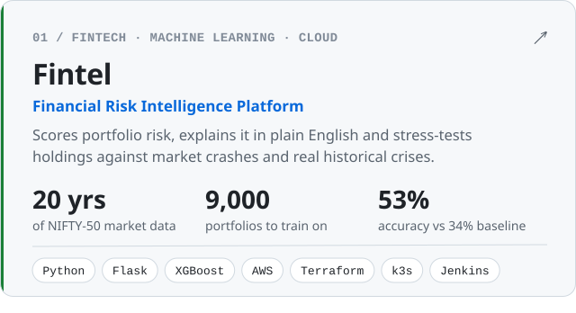
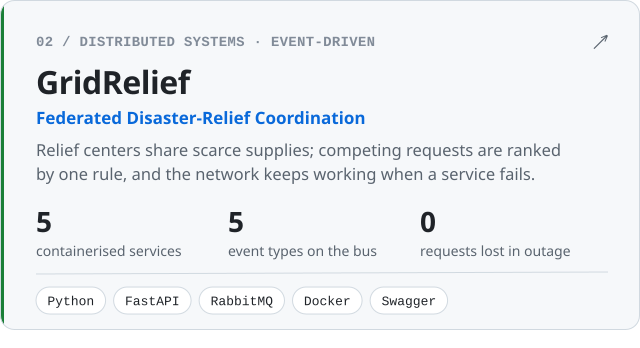
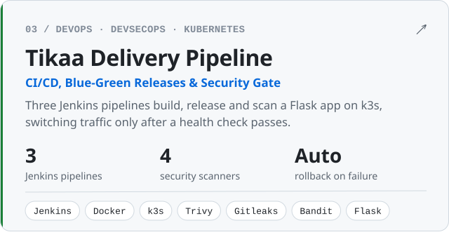
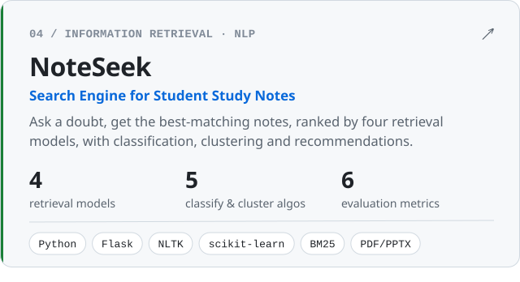
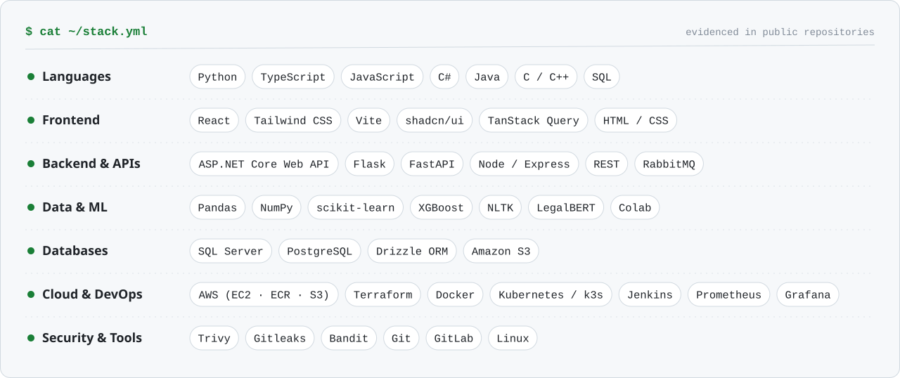
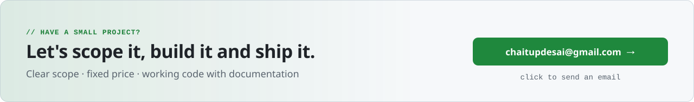

<a href="https://chaitanya697.github.io/portfolio/">
  <picture>
    <source media="(prefers-color-scheme: dark)" srcset="assets/hero-dark.svg">
    
  </picture>
</a>

  
  
  

 

## About

I build complete systems, from the React interface to the API, the database and the cloud pipeline that ships it.
My recent work spans **fintech risk analytics**, **event-driven microservices** and **DevSecOps on Kubernetes**, and I care about
the unglamorous parts: infrastructure as code, honest model metrics and secure-by-default deployments.

| Education | Experience | Focus |
|:--|:--|:--|
| **B.Tech, Computer Science (IT)** SRM Institute of Science and Technology, Chennai Final year · CGPA **9.2 / 10** | **Software Development Intern** Full-stack application development | Full-stack web & REST APIs Cloud & DevOps on AWS Applied ML & NLP (LegalBERT research) |

 

## GitHub at a Glance

<picture>
  <source media="(prefers-color-scheme: dark)" srcset="assets/stats-dark.svg">
  
</picture>

Refreshed every day by a <a href=".github/workflows/stats.yml">GitHub Action</a>, self-hosted with no third-party stats services.

  

## Featured Work

<a href="https://github.com/Chaitanya697/fintel-risk-intelligence"><picture><source media="(prefers-color-scheme: dark)" srcset="assets/card-fintel-dark.svg"></picture></a>
<a href="https://github.com/Chaitanya697/gridrelief"><picture><source media="(prefers-color-scheme: dark)" srcset="assets/card-gridrelief-dark.svg"></picture></a>
<a href="https://github.com/Chaitanya697/devops-pbl3"><picture><source media="(prefers-color-scheme: dark)" srcset="assets/card-tikaa-dark.svg"></picture></a>
<a href="https://github.com/Chaitanya697/Noteseek"><picture><source media="(prefers-color-scheme: dark)" srcset="assets/card-noteseek-dark.svg"></picture></a>

<b>More projects</b>

| Project | Description | Stack |
|:--|:--|:--|
| [**ShieldGig**](https://github.com/Chaitanya697/shieldgig-devtrails-2026) | AI-powered parametric income insurance for q-commerce delivery partners · Guidewire DEVTrails 2026 | React · Tailwind · AI/ML design |
| [**BudgetBuddy**](https://github.com/Chaitanya697/BudgetBuddy) | Full-stack personal finance tracker with auth, transactions and dashboards | React · TypeScript · Express · PostgreSQL |
| [**Quiz Leaderboard**](https://github.com/Chaitanya697/bajaj_Quiz_Leaderboardapp_RA2311031010043) | Polls a quiz API, de-duplicates rounds and builds a ranked leaderboard | Java · REST |
| [**Portfolio**](https://github.com/Chaitanya697/portfolio) | Personal website on GitHub Pages | HTML · CSS · JavaScript |

 

## Tech Stack

<picture>
  <source media="(prefers-color-scheme: dark)" srcset="assets/stack-dark.svg">
  
</picture>

 

## How I Build

| Principle | In practice |
|:--|:--|
| **Infrastructure as code** | Fintel's AWS infrastructure (S3, ECR repositories, security group, EC2) is provisioned with Terraform |
| **Secure by default** | Non-root containers, no access keys in code (IAM instance roles) and a CI security gate running Bandit, pip-audit, Gitleaks and Trivy |
| **Honest metrics** | Models are tested on unseen years and every risk report shows its real accuracy (53% vs a 34% baseline), not a cherry-picked number |
| **Designed to fail safely** | Durable message queues so no request is lost when a service is down; blue-green releases that roll back on a failed health check |

 

## Work With Me

Available for **freelance projects** with a clear scope and a fixed price.

| Service | What's included |
|:--|:--|
| **Python & automation** | Scripts, Excel / CSV / PDF processing, API integrations |
| **Data** | Cleaning, analysis and small dashboards |
| **Frontend** | React / TypeScript bug fixes and features |
| **Backend** | REST APIs in ASP.NET Core, Flask, FastAPI or Express |
| **Databases** | SQL queries, schema design and fixes |
| **Deployment** | Docker, CI/CD pipelines and AWS setup |

<a href="mailto:chaitupdesai@gmail.com">
  <picture>
    <source media="(prefers-color-scheme: dark)" srcset="assets/contact-dark.svg">
    
  </picture>
</a>
